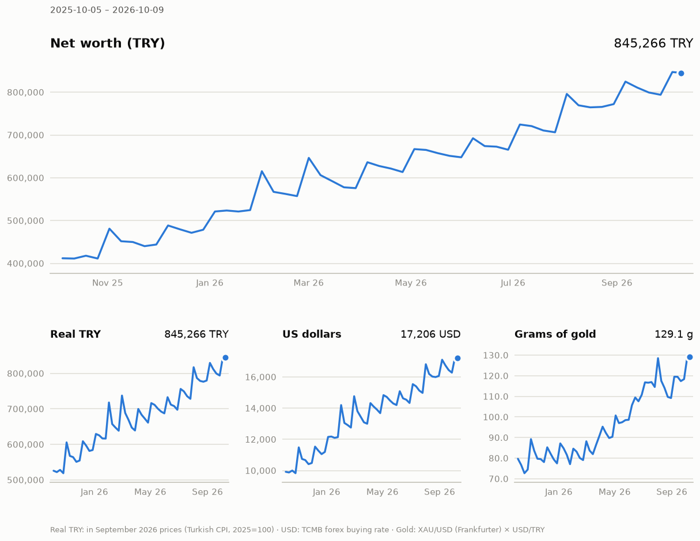
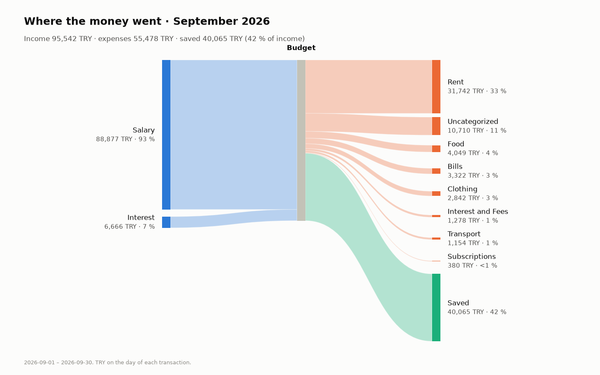

# financeproject 03

A personal finance program for a household in Türkiye. The goal covers the
personal balance sheet and net worth, transactions and cash flow, cash-flow
forecasting, investment and asset analytics, debt management, and a
mathematical analysis and scenario engine. Monarch and Firefly III served as
models. The models used come from academic work, and each one's source is
documented.

The project grows version by version. **00** laid the foundation: a
double-entry ledger, exchange rate, gold and CPI data, net worth in four units.
**01** brought the money in and explained it: bank statement import (Ziraat
Bankası), a categorizer that learns from the ledger, installment purchases,
the income statement, the cash flow statement, a Sankey diagram, recurring
payments, household financial ratios, and why net worth changed. **02** was
about debt: loans with their payment plans, payments split into principal,
interest and taxes, the annual cost rate of any credit offer, cash or
installments, plans for paying off several debts, and what debts weigh once
inflation is counted. **03** is about investments: fund prices from TEFAS and
share prices from Borsa İstanbul, time- and money-weighted returns in four
units, risk with a backtest of the value at risk, and concentration with the
deposit insurance check; it also reads credit card lists from PDF. What
changed in this version: [UPDATE_LOG.md](UPDATE_LOG.md). Methods and
references: [docs/METHOD.md](docs/METHOD.md). Data sources:
[docs/DATA_SOURCES.md](docs/DATA_SOURCES.md).

- **Double-entry ledger** (SQLite). Every transaction balances to zero in every
  unit. Buying and selling currency, gold, funds and shares goes through
  trading accounts (Selinger). Amounts are stored as `Decimal`; floats are
  never used for money.
- **Net worth in four units:** Turkish lira (TRY, the headline unit), real TRY
  (deflated by the CPI), US dollars and grams of gold.
- **Bank statements:** Ziraat Bankası's account statements in Excel (.xlsx) or
  HTML, checked line by line against the bank's running balance and totals,
  and its credit card lists in PDF. Card purchases, transfers, fees, cash
  withdrawals, bills, loan installments and card installments are recognized;
  a transfer seen on both accounts' statements is booked once. CSV files with
  any column layout still work.
- **Categories:** rules first, then a naive Bayes model learned from the
  ledger's own categorized transactions. `finance categorize --evaluate`
  measures how often its confident guesses are right.
- **Installments** (taksit): a card purchase in installments is a debt from
  the day it is made; its schedule shows the installment load of the coming
  months. A card list's installment lines are matched with the plans.
- **Loans and debt decisions:** payment plans with KKDF and BSMV, payments
  split into principal, interest and taxes, the annual cost rate (yıllık
  maliyet oranı) of any offer, cash or installments, avalanche and snowball,
  every debt's real burden under inflation.
- **Investments:** daily fund prices (TEFAS) and share prices (Borsa
  İstanbul), splits and bonus issues; time-weighted and money-weighted
  returns of the portfolio and of each account, in TRY, real TRY, dollars and
  gold; volatility, the largest fall, value at risk and expected shortfall
  with Kupiec's and Christoffersen's backtests, correlations; shares by
  holding, bank and currency, and deposits against the TMSF insurance limit.
- **Reports:** balance sheet, net worth over time, income statement, cash flow
  statement, Sankey diagram, change in net worth split into saving, exchange
  results and revaluation, household ratios against published benchmarks,
  recurring and upcoming payments, debts, returns, risk, concentration.
- **Data sources:** the daily exchange rate bulletin of the Central Bank of the
  Republic of Türkiye (TCMB), Frankfurter XAU/USD for gold, the Turkish CPI
  from EVDS3 (with a key) or the TCMB inflation table, TEFAS for funds, Yahoo
  Finance for Borsa İstanbul shares, and a CPI copy shipped with the package.
- **Tests:** 216 pytest tests, among them property tests on random ledgers
  (Hypothesis), a check of the CPI against TurkStat's real series, a bank's
  published example of the annual cost rate, the spreadsheet function XIRR's
  example, Kupiec's acceptance regions as tabulated by Jorion, and made-up bank
  statements and a card list PDF in Ziraat Bankası's formats.





## Quick start

Requires Python 3.11 or newer. Create a virtual environment and install the
package with its development tools:

```sh
python -m venv .venv
# Activate it
#   Windows (PowerShell):  .venv\Scripts\Activate.ps1
#   macOS and Linux:       source .venv/bin/activate
pip install -e ".[dev]"     # sqlalchemy, pandas, httpx, typer, rich, platformdirs, python-calamine, pypdf, matplotlib, pytest, hypothesis
```

With the environment active:

```sh
finance init                # creates your ledger in the user data directory
finance demo                # a separate demo ledger: made-up household, real prices
finance -d <path printed by demo> balance-sheet
pytest
```

`finance demo --synthetic` works offline with made-up prices. `python -m
financeproject` does the same as `finance`. On systems where `python` points
to Python 2 or is missing, use `python3`.

## Usage

Account names are paths separated by `:`. The first part is `Assets`,
`Liabilities`, `Equity`, `Income` or `Expenses`. Commands accept any unique
part of an account name instead of the full path: `Groceries` →
`Expenses:Food:Groceries`. Matching ignores case and Turkish letters, so
`Gida` finds `Gıda`. Every command explains itself with `--help`.

```sh
# Accounts (kinds: finance account kinds)
finance account add "Assets:Bank:Ziraat Checking" --kind checking --institution "Ziraat Bankası" --owner Me
finance account add "Assets:FX:USD Account" --kind fx --commodity USD
finance account add "Assets:Gold:Grams" --kind gold                 # unit: XAU_G (24 carat, grams)
finance account add "Liabilities:Credit Card:Bonus" --kind credit_card
finance account add "Expenses:Food:Groceries"
finance account add "Income:Salary"

# Opening balances (natural sign: a debt is entered as a positive amount owed)
finance opening "Ziraat Checking" 25000 --date 2026-10-01
finance opening Bonus 3500 --date 2026-10-01

# Daily transactions (amounts may be written 1,234.56 or 1.234,56)
finance income 65000 Salary --to "Ziraat Checking"
finance expense 450.75 Groceries --from Bonus --payee Migros
finance expense 36000 Electronics --from Bonus --installments 6   # 6 monthly installments from next month
finance transfer 3500 --from "Ziraat Checking" --to Bonus             # paying the card
finance exchange --from "Ziraat Checking" --paid 49126.70 --to "USD Account" --received 1000
finance txn add --description "Gift" -p "Expenses:Gifts=1500" -p "Ziraat Checking"

# Prices
finance price update                    # TCMB rates, gold, CPI, funds, shares; fills in missing days
finance config show                     # where the files are
```

Numbers are shown as `1,234.56`. `finance config number-format "1.234,56"`
switches to the Turkish style.

### Importing bank statements

Download the account movements ("Hesap Hareketleri") from Ziraat Bankası as
Excel or HTML, then:

```sh
finance import Hesap_Hareketleri.xlsx --account "Ziraat Checking" --opening --dry-run   # preview
finance import Hesap_Hareketleri.xlsx --account "Ziraat Checking" --opening
```

```
Ziraat Bankası statement, 2026-09-01 – 2026-09-30, 16 lines; balance 12,500.00 → 35,086.32
…
Opening balance added: 12,500.00 on 2026-09-01 (the balance before the statement's first line)
16 transactions added, 1 loan installment split, 0 were already in, 13 uncategorized (…).
Balance check: the bank's balance on 2026-09-30 is 35,086.32; the ledger's is the same.
```

- The bank is recognized from the file. The lines are put in date order, and
  the bank's running balance must add up line by line; the debit and credit
  totals must match too. Otherwise nothing is imported.
- `--opening` is for a new account: it starts the account at the balance the
  statement had before its first line.
- After the import the ledger's balance is compared with the bank's closing
  balance. A difference means missing transactions or a missing opening
  balance.
- Lines carry the bank's receipt number, so the same statement downloaded as
  Excel and as HTML, or two overlapping statements, are imported once.
- The payee is read from the description: the shop of a card purchase, the
  other person of a mobile transfer, the company of a bill; the bank's fees
  and tax get the bank, cash withdrawals "ATM".
- A loan installment line names the loan's number. When a loan with that
  number is defined (`finance loan add … --reference`), the line is split into
  principal, interest and taxes; otherwise the import says which loan numbers
  it saw.
- Only the transactions are read. The account holder's name, address and IBAN
  at the top of the statement are skipped.

### Importing card lists

Internet banking shows a credit card's transactions ("Kart Hareketleri"); save
the page as PDF, then:

```sh
finance import Kart_Hareketleri.pdf --account Bonus --payments-from "Ziraat Checking" --dry-run
finance import Kart_Hareketleri.pdf --account Bonus --payments-from "Ziraat Checking"
```

```
Ziraat Bankası card list, 2026-07-01 – 2026-07-28, 11 lines
…
11 transactions added, 1 installment purchase booked in full with its plan, 0 were already in, 9 uncategorized (…).
  2 installments of purchases made before the ledger, booked one by one
```

- **Installments.** The first installment of a purchase books the whole
  purchase with its plan, as `expense --installments` does. Next month's list
  shows installment 2: the plan is found (same total, same count, bought
  within a week) and the line is skipped. Installments of purchases made before
  the ledger are booked one by one as they come.
- **Payments.** With `--payments-from` a payment of the card becomes a
  transfer from that account. If the bank account's statement shows the same
  payment and a rule sends it to the card, whichever is imported second finds
  the transfer already there (the same two accounts and amount, within three
  days) and skips it.
- The list has no balances or totals to check against. The payee is the shop
  without the place; bills paid by the card get the company. The account
  holder's name above the list is not read. Lines in other currencies than TL
  are refused for now.

### Importing CSV files

The standard layout has these headers, in any order. Example file:
[examples/transactions_standard.csv](examples/transactions_standard.csv).

```
date,description,amount,account,counter_account,commodity,payee,note
2026-10-01,MİGROS KONYA,-450.00,Bonus,,,Migros,
2026-10-02,Salary,"65,000.00",Ziraat Checking,Income:Salary,,,
```

`amount` is the change of `account` from the holder's point of view: negative
is money out (a credit card purchase too), positive is money in. A bank's own
CSV export is read through a column mapping:

```sh
finance import statement.csv --account "Ziraat Checking" --skip 2 --date-format "%d.%m.%Y" \
    --columns "date=İşlem Tarihi,description=Açıklama,outflow=Borç,inflow=Alacak" --dry-run
```

The delimiter, the decimal separator and the encoding (UTF-8, Windows-1254,
ISO-8859-9) are detected; `--delimiter`, `--decimal` and `--encoding` set them.
If any row is invalid, nothing is written and all errors are listed.

### Categories

Every imported row gets its counter account from, in this order: the file
itself, the first matching rule, the learned model (when it is at least 80 %
sure), or `Expenses:Uncategorized` / `Income:Uncategorized`. Installment lines
of defined loans go to the loan.

```sh
finance rule add migros Groceries                  # "migros" in the description → Expenses:Food:Groceries
finance rule add "kahve\s+dunyasi" Coffee --regex
finance categorize --dry-run                       # rules, then the model, on uncategorized transactions
finance categorize
finance categorize --evaluate                      # how well would the model have done so far?
finance txn recategorize 251 "Expenses:Gifts"      # fix one; the model learns from it
```

On the demo household, guessing each transaction from the earlier ones only,
the model was right 90.7 % of the time; the guesses that reached 80 %
probability, four in five, were right 98.8 % of the time.

### Loans and debts

A loan is a liability account plus its terms. Rates are as in the contract: the
monthly interest rate, without KKDF and BSMV (15 % of the interest each on
consumer and vehicle loans by default, 0 on others; `--kkdf` and `--bsmv`
change them).

```sh
# A new loan, paid out into the checking account; its statement lines are recognized by --reference
finance loan add "Car loan" "Liabilities:Loans:Car" --principal 300000 --rate 2.99 --count 36 \
    --first-due 2026-11-15 --paid-into "Ziraat Checking" --reference 12345678-0001
# A loan taken before the ledger: the installments due by --opening-on count as paid.
# --installment instead of --rate: the rate is worked out from the installment on your papers.
finance loan add "Old loan" "Liabilities:Loans:Old" --principal 100000 --installment 6924.20 --count 24 \
    --first-due 2026-05-13 --opening-on 2026-10-01
finance loan list                                   # owed, rates, annual cost rate, next installment, left to pay
finance loan schedule "Car loan" --csv plan.csv     # the payment plan, with what is paid
finance loan pay "Car loan" --from "Ziraat Checking"                      # the next installment, as planned
finance loan pay "Car loan" --from "Ziraat Checking" --amount 20000 --extra  # an early repayment

finance debt                                        # every debt, and the installments left in today's money
finance payoff --budget 15000 --rate "Bonus=3.5" --minimum "Bonus=3000"   # avalanche or snowball
finance apr --amount 10000 --count 12 --installment 888.49 --last 888.47 --fees 50
finance cash-or-installments --cash 34000 --installment 6000 --count 6 --rate 2.5
```

The annual cost rate of a credit offer, here the worked example of İş
Bankası's note on the yıllık maliyet oranı:

```
Credit 10,000.00; 12 installments of 888.49 (the last 888.47), the first in 1 month; fees 50.00
Paid back in all: 10,711.86 (cost 711.86)
Annual cost rate (yıllık maliyet oranı): 13.75 %
Cost a month: 1.079 %; a year 12.95 % simple (× 12), 13.75 % compounded
```

Cash or installments, when the money would earn 2.5 % a month meanwhile:

```
Cash 34,000.00 now, or 6 × 6,000.00 = 36,000.00, the first in 1 month.
The installments charge 1.66 % a month (21.81 % a year) over the cash price.
Money kept meanwhile: 2.50 % a month (34.49 % a year; given).
In today's money the installments cost 33,048.75: 951.25 less than cash → the installments are cheaper.
```

Without `--rate` the installments are discounted at the CPI's inflation of the
last twelve months: a comparison in real terms.

### Investments

A fund is the commodity `TEFAS.<fund code>`, a Borsa İstanbul share
`BIST.<ticker>`. Each is held in its own account, bought and sold with
`exchange`:

```sh
finance commodity add TEFAS.AFT "Ak Portföy Yeni Teknolojiler" --kind fund --price-source tefas
finance commodity add BIST.THYAO "Turkish Airlines" --kind stock --price-source yahoo --decimals 0
finance account add "Assets:Investments:AFT" --kind fund --commodity TEFAS.AFT --institution "My Broker"
finance account add "Assets:Investments:THYAO" --kind stock --commodity BIST.THYAO --institution "My Broker"
finance exchange --from "Ziraat Checking" --paid 25000 --to AFT --received 20230.51
finance price update                       # fund prices from TEFAS, share prices from Yahoo Finance
finance split THYAO 2 --date 2027-03-15    # a bonus issue of 100 %: one new share for every share held

finance returns                            # time- and money-weighted, in four units; --start, --end
finance returns --account "Assets:Investments"   # a portfolio of your choice: everything under a path
finance risk                               # volatility, largest fall, value at risk and its backtest, correlations
finance concentration                      # shares by holding, bank and currency; deposit insurance
```

- **The portfolio** is every fund, stock, gold and foreign currency account
  unless `--account` chooses others (a brokerage's cash account, a time
  deposit). Money that crosses its boundary is a cash flow: buying with money
  from the bank brings money in, selling into it or spending from a currency
  account takes money out. Interest, dividends (`Income:Dividends`,
  `Income:Investments`) and investment fees (`Expenses:Investments`) booked on
  the portfolio's accounts are part of the return.
- **Splits.** Yahoo gives past share prices adjusted for later splits; the
  program turns them back into each day's price, so they match the number of
  shares the ledger held that day. Record a split or bonus issue with `finance
  split`; `price update` reminds you of one the ledger does not have yet.
  Dividends are not fetched: book them as income when they are paid.
- Fetching prices tells TEFAS and Yahoo which fund and share codes are asked
  for; nothing else is sent.

### Reports

```sh
finance balance-sheet                   # today's balance sheet; --date, --owner Dad
finance networth --frequency month      # net worth over time in four units; --csv
finance chart                           # networth.png in the output folder
finance income-statement --months 6     # income and expenses by category and month; --real, --depth, --csv
finance cash-flow --months 6            # where the money in the cash accounts came from and went
finance sankey --month 2026-09          # Sankey diagram (PNG)
finance change --month 2026-09          # why net worth changed; --unit real, usd or gold
finance ratios                          # household ratios against benchmarks
finance recurring                       # subscriptions, bills, rent, salary found in the ledger
finance upcoming --days 30              # payments expected next: recurring, card installments, loan installments
finance installments                    # installment purchases and their schedule
finance debt                            # debts: cost, real rate, what is left in today's money
finance returns                         # returns of the investments in four units
finance risk                            # risk of the investments
finance concentration                   # where the money is; deposits against the insurance limit
finance cpi                             # the CPI of the last 13 months
finance backup                          # a copy in the backups folder
```

### EVDS key (optional)

Everything works without a key. With a key the CPI comes as official index
levels and past exchange rates arrive in one request.

1. Sign up at https://evds3.tcmb.gov.tr.
2. Copy the API key from your profile page.
3. Save it: `finance config evds-key KEY`. It goes into `settings.toml` in your
   user configuration directory, readable only by you.

## Example output

A made-up household with real exchange rates and gold prices
(`finance demo`, 2026-10-17). Its fund and share are made up, and so are their
prices:

```
╭─ Net worth ─────────────────────────────────────────────────────────────────────────────────────────────────╮
│ TRY                      774,902.42                                                                         │
│ Real TRY                 774,902.42   in September 2026 prices; no CPI after that yet                       │
│ USD                       15,699.85   49.3573 TRY · 2026-10-16 · TCMB forex buying                          │
│ Grams of gold              117.50 g   6,595.00 TRY/g · 2026-10-16 · Frankfurter XAU/USD × TCMB forex buying │
╰─────────────────────────────────────────────────────────────────────────────────────────────────────────────╯
```

From the end of October 2025 to 17 October 2026 this household's net worth
grew by 100 % in TRY, 59 % in real terms and 70 % in dollars; in grams of gold
by 64 %, and from November to January it fell from 74.7 g to 64.8 g, because
gold gained value faster than the household saved. `finance change` shows
where September's change came from:

```
Change in net worth · TRY
Net worth on 2026-08-31       699,432 TRY
Income                        +95,542 TRY
Expenses                      -55,478 TRY
Net saving                    +40,065 TRY
Revaluation                   -11,049 TRY
  XAU_G                       -11,656 TRY
  USD                          +2,048 TRY
  DEMO.SHARE                   -1,243 TRY
  DEMO.FUND                      -198 TRY
Net worth on 2026-09-30       728,447 TRY
```

The household saved 40,065 TRY in September, but the gold it held lost 11,656
TRY of value. Measured in grams of gold the same month looks better: the
lira, dollars, fund and share held gained 4.9 g against gold.

### Investments

The household saves in dollars and gold in turns every month, buys the fund
every month and the share every third month. `finance returns` (some columns left out):

```
Investments · 2025-10-01 – 2026-10-17 (382 days)
Unit                         Money in         End        Gain  Time-weighted   a year  Money-weighted a year
TRY                        395,017.00  442,923.07   47,906.08        22.39 %  21.30 %                16.82 %
real TRY (2026-09 prices)  467,219.43  442,923.07  -24,296.36        -4.38 %  -4.19 %                -6.83 %
USD                          9,086.15    8,973.81     -112.34         2.98 %   2.85 %                -1.66 %
gold (g)                       68.547      67.160      -1.386        -4.41 %  -4.22 %                -2.65 %

Account (TRY)                   Money in         End        Gain  Time-weighted  Money-weighted a year
Assets:FX:USD Account         117,316.54  134,570.70   17,254.16        18.85 %                18.64 %
Assets:Gold:Gram Gold         166,958.05  199,537.03   32,578.98        28.18 %                23.40 %
Assets:Investments:Demo Fund   59,589.85   63,490.06    3,900.21        21.25 %                13.53 %
Assets:Investments:Demo Share  51,152.56   45,325.28   -5,827.28        -6.29 %               -22.89 %
```

In lira the investments earned 22 % in the year, but less than inflation: in
real terms they lost 4 %, and they did a little worse than holding gold. The
two measures can differ a lot: the share lost 6 % time-weighted, but the money
put into it lost 23 % a year, because its January purchase came near its
high. `finance risk`:

```
Risk · 2025-10-01 – 2026-10-17 · 379 market days · value 442,923.07 TRY
Volatility a year: 8.9 %
Largest fall: 9.5 % from the peak of 2026-03-03 to 2026-06-26; not back yet (228 days)
One day at     VaR       TRY  Expected shortfall        TRY  Normal VaR  Normal shortfall
95 %        0.72 %  3,192.35              1.37 %   6,076.30      0.87 %            1.10 %
99 %        1.64 %  7,257.29              2.50 %  11,068.29      1.25 %            1.44 %
Backtest  Days  Exceptions  Expected  Kupiec p  Independence p  Both p  Verdict
95 %       129           5       6.5     0.543           0.163   0.314  fits
99 %       129           0       1.3     0.107               —       —  fits
Holding     Volatility a year  Largest fall  Correlation with the portfolio
DEMO.FUND               8.1 %         3.5 %                            0.11
DEMO.SHARE             25.3 %        32.3 %                            0.21
USD                     1.2 %         0.2 %                            0.11
XAU_G                  15.8 %        20.4 %                            0.97
```

On one day in twenty the portfolio may lose more than 0.72 % (3,192 TRY);
on those days it lost 1.37 % on average. The losses are fatter-tailed than a
normal distribution says (2.50 % against 1.44 % at 99 %). Tested day by day
against the 250 days before, the value at risk held. Gold, almost half of the
portfolio, moves it nearly alone (correlation 0.97). `finance concentration` finds 73 % of the
financial assets at one bank and 60 % in lira; the deposits there are within
the insured 1,200,000 TRY.

### Debts

The household also pays a consumer loan taken before the ledger starts and
pays back money borrowed from a friend. `finance debt` (some columns left
out):

```
Debts · 2026-10-17 · inflation 29.7 % a year (CPI, 12 months to 2026-09)
Debt                                          Owed  Rate a month  Cost a year  Real a year  Left to pay  In today's money
Liabilities:Credit Card:Sample Card         22,605.88             —            —            —            —                 —
Consumer loan                               29,305.86       2.990 %      58.03 %      21.82 %    34,035.89         31,853.98
Liabilities:Personal:Borrowed from a Friend  5,000.00             —            —            —            —                 —
Liabilities:Credit Card:Sample Card: 12,708.16 of the 22,605.88 owed are installments billed in later months.
```

The loan's contractual rate of 2.99 % a month becomes 3.887 % with KKDF and
BSMV and 58 % a year compounded; after 29.7 % inflation it still costs 21.8 %
a year in real terms. With 9,000 a month for the two debts,
`finance payoff --budget 9000 --minimum "Friend=1250"`:

```
Budget 9,000.00 a month: least payments 6,112.27 + extra 2,887.73
Plan                           Debt-free in  Interest and taxes  Order (month paid off)
As now: least payments only        7 months            4,730.02  Borrowed from a Friend (4), Consumer loan (7)
Avalanche: highest rate first      5 months            3,024.10  Borrowed from a Friend (4), Consumer loan (5)
Snowball: smallest debt first      5 months            3,305.31  Borrowed from a Friend (2), Consumer loan (5)
Avalanche saves 281.21 in interest; snowball clears a first debt sooner, which helps some people keep going.
```

## Layout

| Module | Contents |
|---|---|
| `financeproject/core/` | Pure calculations, no database or network: amounts (`money`), dates, text folding, account kinds (`kinds`), the price book (`prices`), CPI (`inflation`), valuation (`valuation`), the split of a change in value (`decompose`), recurring series (`recurring`), loans and the annual cost rate (`loans`), returns (`returns`), risk (`risk`), HTML tables (`htmltable`) |
| `financeproject/ledger/` | SQLAlchemy models, database, accounts, transaction rules and splits (`transactions`), installments, loans and their payments (`loans`), balance queries |
| `financeproject/prices/` | Clients for the TCMB XML, Frankfurter, EVDS3, the TCMB CPI table, TEFAS and Yahoo Finance; storing and updating |
| `financeproject/ingest/` | Reading files (`tables`, `pdf`), bank statements (`statement`) and their templates (`banks/`: account statements, card lists), CSV, writing imports (`importer`), rules, the learned categorizer (`learn`) |
| `financeproject/reports/` | Balance sheet, net worth series and chart, change in net worth (`change`), income statement (`income`), cash flow, Sankey, ratios, recurring payments, debts (`debt`), investments: returns, risk, concentration (`investments`) |
| `financeproject/cli.py` | Command line (`finance`) |
| `financeproject/demo.py` | The made-up demo household |
| `financeproject/data/` | Public data shipped with the package: the CPI copy ([description](financeproject/data/README.md)) |
| `tests/` | pytest + Hypothesis; `fixtures/` holds saved real TCMB and Frankfurter answers and made-up Ziraat Bankası statements and a card list |
| `docs/` | Method, data sources, example figures |

## Data and privacy

The repository is public, so **personal data never goes into it**.

- **Location:** the ledger, backups and charts live outside the repository, in
  the user data directory of the operating system (`finance config show`
  prints it):

  | System | Folder |
  |---|---|
  | Windows | `%LOCALAPPDATA%\financeproject` |
  | macOS | `~/Library/Application Support/financeproject` |
  | Linux | `~/.local/share/financeproject` |

  `-d` or the `FINANCEPROJECT_DB` environment variable selects another file.
- **Bank statements and card lists** are read on your computer; nothing is
  sent anywhere. Only the transactions are taken: the name, address and IBAN
  in a statement's header and the name above a card list are not stored. The
  statements and the card list under `tests/fixtures` are made up, and so are
  all names, numbers and amounts in the examples.
- **Prices:** `finance price update` asks TCMB, Frankfurter, TEFAS and Yahoo
  Finance for prices. The last two learn which fund and share codes are asked
  for; no amounts or other data are sent.
- **Loans:** their terms and numbers are kept in your ledger only.
- **.gitignore:** patterns such as `*.sqlite`, `backups/`, `output/` and
  `settings.toml` keep such files out as a second safety net.
- **Permissions:** the ledger, backups and the settings file are created
  readable only by the user (0600 on macOS and Linux).
- **Demo data:** `finance demo` never writes into the real ledger.
- **Encryption:** the ledger file itself is not encrypted yet. An encrypted
  disk (BitLocker, FileVault, LUKS) is recommended. Encrypting the file itself
  (SQLCipher) is among the next steps.

## Design principles

The "points to watch" from the first evaluation, and how the versions meet
them:

1. **The biggest risk is data entry.** Open banking in Türkiye (ÖHVPS) is open
   only to licensed providers, so statement import is taken seriously:
   - **00:** CSV with column mapping, duplicate checks, rules, all-or-nothing
     imports.
   - **01:** the Ziraat Bankası template; every statement checked against the
     bank's running balance and totals; the ledger compared with the bank's
     closing balance; a categorizer that learns from corrections, with its
     accuracy measured.
   - **02:** more kinds of statement lines recognized; loan installments on a
     statement are split into principal, interest and taxes without typing.
   - **03:** card lists from PDF; card installments matched with their plans;
     a transfer seen on two statements booked once; fund and share prices
     fetched instead of typed.
2. **The efficient frontier is fragile at household scale** (Michaud 1989;
   DeMiguel et al. 2009). Version 05 will show it with shrinkage
   (Ledoit-Wolf), resampling, a 1/N comparison and out-of-sample checks, as
   description, not advice.
3. **Say how current and how sure each number is.** Every value is shown with
   its price date and source. Prices older than 7 days and assets without a
   price are flagged; they are not guessed and not added to net worth. The
   learned categorizer only acts when it is sure enough, and reports its
   measured accuracy. The debt tools state their assumptions and show both
   repayment orders instead of choosing one. The value at risk comes with its
   own backtest, and the normal estimate is shown next to the historical one
   so that fat tails show.
4. **Inflation makes everything look "abnormal".** Real TRY is everywhere: the
   income statement and cash flow have `--real`, the change in net worth shows
   how much inflation took from the lira held, every loan has a real interest
   rate, and 03 gives every return in real TRY, dollars and gold as well.
5. **Privacy.** See "Data and privacy" above.

## Roadmap

| Version | Contents | Status |
|---|---|---|
| **00** | Ledger, accounts, manual entry, CSV import and rules, TCMB, gold and CPI, net worth in four units, liquidity | ✅ |
| **01** | Bank statement template (Ziraat Bankası), installment model, cash flow and income statement, Sankey, recurring payments, household financial ratios, decomposition of net worth changes, learning categorizer | ✅ |
| **02** | Debt module: loans and payment plans, payments split from statements, the annual cost rate, avalanche and snowball, cash or installments, real debt burden | ✅ |
| **03** | Investments: TEFAS and BIST prices, TWR and XIRR, real returns, volatility, maximum drawdown, VaR and CVaR with backtests, correlation, concentration; card lists from PDF | ✅ this version |
| **04** | Wall monitor (kiosk), guest mode | ⏸ deferred for now |
| **05** | Portfolio theory: efficient frontier, GMV, tangency portfolio, HRP, 1/N | next |
| **06** | Cash-flow forecasting: known flows and statistical forecasts, prediction intervals, backtests | |
| **07** | Anomaly detection | |
| **08** | Scenario engine: scenarios, sensitivity (Sobol), Monte Carlo, historical stress tests | |
| **09** | Personal inflation, goals, budgets | |
| **10** | AI: MCP server, weekly summary, reading PDF statements | ⏸ deferred for now (card lists in PDF came in 03) |

## Idea pool: what to take from similar apps

All of these ideas are meant to join the program over time. Any that turn out
not to fit will be changed or reworked. Status: ✅ done, ◐ partly, ☐ planned,
⏸ deferred.

| Source | Idea | Version | Status |
|---|---|---|---|
| Monarch Money | Sankey cash-flow diagram | 01 | ✅ `finance sankey` |
| | Bill and subscription calendar | 01 / 02 | ◐ recurring payments, card and loan installments are listed ahead (`upcoming`); no reminders |
| | Shared household use | 00 | ◐ account owners and per-person balance sheets; no separate logins |
| | "Why did this month change?" | 01 / 10 | ◐ the numbers are there (`finance change`); an AI-written explanation in 10 |
| | Weekly summary | 10 | ⏸ |
| | Forecasts | 06 | ☐ |
| Firefly III | Double-entry ledger | 00 | ✅ |
| | Liabilities with interest (loans, debts, mortgages) | 02 | ✅ `finance loan`: terms, payment plans, payments split into principal, interest and taxes |
| | Rule engine | 00 / 01 | ◐ description or regex → account; amount and payee conditions later |
| | Expected bills | 01 | ◐ found from the ledger, not entered by hand |
| | Savings goals ("piggy banks") | 09 | ☐ |
| | REST API | with a web interface | ☐ |
| | Separate import tool | 00 / 01 / 03 | ◐ CSV with column mapping, the Ziraat Bankası account statements and card lists; more banks as samples arrive |
| Actual Budget | Envelope budgeting | 09 | ☐ |
| | Scheduled transactions | 06 | ☐ recurring payments are detected and loan installments are planned; booking them ahead is open |
| | Custom reports | later | ☐ |
| Sure (Maybe) | Modern net worth interface | with a web interface | ☐ |
| | Access for AI agents | 10 | ⏸ |
| Ghostfolio | X-ray: concentration rules (institution, currency, single asset; TMSF deposit insurance limit) | 03 | ✅ `finance concentration` |
| | Hiding the numbers (Zen mode) | 04 | ⏸ the monitor's guest mode |
| Wealthfolio | TWR and MWR side by side | 03 | ✅ `finance returns` |
| | Splitting a period's change into its sources (income, gains, fees, taxes, FX) | 01 | ✅ `finance change`, in four units |
| | API keys in the operating system keyring | later | ☐ for now a settings file readable only by the user |
| Portfolio Performance | TTWROR, IRR, maximum drawdown and its duration; a reference to check results against | 03 | ✅ its daily TTWROR rule; `returns`, `risk` |
| Beancount, smart_importer | Categorization that learns from past corrections | 01 | ✅ naive Bayes, evaluated in date order |
| hledger | `roi`: TWR and IRR side by side | 03 | ✅ `finance returns` |
| | Forecasts from recurring transactions | 06 | ☐ the recurring series of 01 are ready for it |
| | Balance sheet, cash flow, income statement | 00 / 01 | ✅ |
| Paisa | Bill calendar | 01 | ◐ `finance upcoming` |
| | Goals | 09 | ☐ |
| | Spreadsheet on ledger data | later | ☐ |
| ezBookkeeping | Light enough for a Raspberry Pi | 04 | ⏸ |
| | Receipt scanning (OCR), MCP | 10 | ⏸ |
| Rotki | Encrypted ledger (SQLCipher) | later | ☐ for now disk encryption and owner-only files |
| | Keeping non-sensitive price data apart | later | ☐ |
| ProjectionLab | Monte Carlo and historical backtests | 08 | ☐ |
| | Inspecting single runs, probability of reaching a goal | 08 / 09 | ☐ |

## Not done in this version

### From the 03 plan

- **Interest rates** (the policy rate, deposit rates) as a benchmark and
  risk-free rate are left for 05, where the portfolio models need them.
- **Dividends** are booked by hand as income; Yahoo's dividend events are not
  read.

### Found while building 03

- **TEFAS's new API** (2026) is not documented and gives at most five years
  of prices; it may change again. Yahoo Finance's chart API is unofficial.
  `finance price add` stays as the way to enter a price by hand.
- **Fund orders** are executed at a later day's price; the ledger books a
  purchase on its own day, and returns use each day's published price.
- **Daily returns** count money bought during a day as invested from the
  previous close, as Portfolio Performance does. On a day of a big price move
  a purchase at that day's price shows a small gain or loss that did not
  happen.
- **Rights issues** ("bedelli sermaye artırımı") are not modeled; a bonus issue
  or split is recorded with `finance split`. A split older than the last price
  update is not reported again.
- **Income paid outside the portfolio** (a dividend into a bank account that is
  not part of it) is not seen by `returns`; choose the portfolio with
  `--account` to include the account it is paid into.
- **Value at risk** is for one day and from the past only; the backtest needs
  more than 250 market days. Correlations in TRY include the lira's own moves.
- **Concentration** counts a fund in the currency it is priced in, not in the
  currencies of what it holds. The TMSF limits are written in for 2024–2026
  and have to be updated every year; joint accounts are counted for their
  owner.
- **Card lists** have no balances or totals, so they cannot be checked line by
  line like account statements. Refunds go to `Income:Uncategorized`. Lines in
  other currencies are refused.
- Carried over from 02: bills and scheduled transactions; statement lines of
  loans defined later stay where the import put them. From 01: other banks
  need one sample export each; the housing cost ratio is not computed; EVDS
  has still not been tried with a real key; the gold price is the
  international parity.

## Next steps (proposal for the next version)

1. **Portfolio theory** (05 on the roadmap; 04 stays deferred): the efficient
   frontier, GMV and tangency portfolios, HRP and 1/N on the return series of
   03, with shrinkage and out-of-sample checks, and interest rates from EVDS
   as the risk-free rate.
2. **Bills and scheduled transactions:** confirm a detected recurring payment
   as a bill, get warned when it is late or its amount changes.
3. **Dividends from the data:** suggest the dividends of the shares held from
   Yahoo's events, to be confirmed.
4. **Templates for the other banks** the family uses, one sample each.
